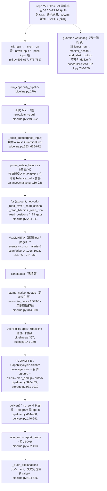

# Wallet Guardian 架構檢視與缺口優先排序（01）

- 對象：`main` 16559ac（tag `v0.4.0-rc.4`），`wallet-guardian/src/guardian`
- 方式：唯讀讀碼與讀文件。本報告**沒有**跑 pytest、沒有連網、沒有讀私人設定；測試結果請以另一條背景程序為準。
- 證據等級：`[讀碼 file:line]` 為本次親自讀到的程式碼；`[文件 file]` 為 repo 內文件；`[推論]` 為依程式碼與已知營運狀況推得、尚未實證。
- 範圍：`guardian run-once --mcm-config`（MCM capability pipeline）。舊的 `run-once --config`（BSC/Lista + Hyperliquid，`SnapshotCycle`）路徑、repo 外的私人 legacy patrol、以及 Grok Bot 雲端排程本身**不在本次讀碼範圍**，需要另外一輪。使用者描述中的 GoPlus 與 Web/X 新聞，在這條 pipeline 裡沒有接上（見 S9），推測是 Grok Bot 或 legacy patrol 另外做的 `[推論]`。

---

## 1. 摘要

1. **游標先推進、告警後寫入，中途中斷就永久漏報。** 每個區塊段先把 events 跟 cursor 寫進 DB（`alerts=[]`），告警要等整輪最後一次 commit 才寫。中間任何例外或被砍，下一輪從已推進的 cursor（只重疊 2 個區塊）繼續，沒有任何機制回補（P0-1）。
2. **log 掃描中途出現任何 `SecurityError`，整輪就中止。** 例如 redirect、endpoint 檢查失敗，或第一次連某個 log/indexer host 時 DNS 失敗。這類錯誤會一路往外拋，而外層只接 `BudgetExhausted`/`BootstrapStop`。所以一條鏈出事，所有鏈都不會出告警；再疊上第 1 點，就變成永久漏報（P0-2）。
3. **代幣 ≥ $1k 的告警路徑不存在。** 程式只幫原生幣轉帳填 USD 報價，ERC-20 轉帳一律算成 `valuation_unknown`、`alert=False`（P0-3）。
4. **非 ETH 系原生幣（BSC/Polygon/Avalanche/Solana/Bitcoin），用 `init` 或範例設定跑時不會發大額告警。** 沒設 `native_unit_thresholds` 又沒有價格來源時，餘額變動會被判成 `threshold_unavailable`，baseline 照樣前進，不進 outbox；Solana 連轉帳候選都不產生（P0-4）。
5. **沒有可用的 dead-man switch。** watchdog 的告警只寫進 outbox，只有 `run-once` 會送出；`degraded` 的 exit code 是 0；長期 degraded 時 watchdog 會一直判成 blind，等於沒有訊號（P0-5）。
6. 延遲主要卡在排程頻率：白天每 3 小時一次，夜間有約 9 小時空窗。BSC internal tx 晚 3 小時，原因是排程，不是資料源（P1-2）。
7. 覆蓋矩陣只回答「讀不讀得到」，沒回答「能不能告警」。可分享版應該再加一欄「可告警」（P1-4）。
8. 資源樹沒有漂移（已有測試）；三份 source registry 是不同用途的舊產物，不算資料矛盾，但已過期（P2）。
9. 建議順序：先修 P0-1、P0-2、P0-5（工作量 S–M），再補 P0-3、P0-4；**P0 修完之前不要開跑 72h/24 輪 shadow**，否則驗證的是一個已知會漏報的設計。

---

## 2. 架構與資料流

### 2.1 一輪 `run-once --mcm-config` 的實際順序

### 2.2 來源 → 掃描 → 規則 → 事件 → 去重 → 通知

| 階段 | 元件 | 重點 |
|---|---|---|
| 來源 | `sources/transport.py` `ReadOnlyTransport`、`sources/resolver.py`、`sources/budget.py`、各 indexer client（etherscan/nodereal/blockscout/alchemy/esplora/tron_grid/helius） | 只做讀取，送出前先檢查操作、SSRF，DNS 只解析一次並釘住位址（transport.py:630-660）。預算與 deadline 以 `BudgetExhausted`/`BootstrapStop` 表示。 |
| 掃描 | `scan/drive.py`（token log、approval log、indexer 分頁、BSC internal）、`scan/window.py`（切段、二分） | 每個成功的 leaf 立刻 commit events 跟 cursor（COMMIT A）。`_finish` 決定 coverage 是 complete 還是 partial（drive.py:938-980）。 |
| 原生餘額 | `balances/native.py` | 在確定區塊讀餘額，跟 baseline 版本綁定後各自 commit，告警直接寫進 outbox，不等 COMMIT B。 |
| 規則 | `rules.py` `AlertPolicy` | ETH 系用 wei 門檻，其他鏈用 `native_unit_thresholds`，或靠新鮮 USD 報價套 USD 門檻；權限變更不看門檻；第一次觀察只出 baseline_summary。 |
| 事件／去重 | `storage.py` `commit_capability_cycle`、`alert_dedup`、`chain_events` | dedup_key 等於 sha256(tenant, wallet, network, kind, identity)。`chain_events` 只有 `comparison.py:380` 會讀，**沒有拿來重建告警**。 |
| 通知 | `delivery.py`、`senders/telegram.py` | 預設 `outbox_only`；加 `--no-send` 時列保持 pending、不送出（delivery.py:160-162）。 |
| 解釋 | `explanations/engine.py` | 在 COMMIT B 之後、用剩下的回合預算跑；只有 Lista 一個 explainer，`implementations: []`（config/explainers/lista-stakemanager.json）。 |
| 健康 | `scheduler.py` `Watchdog` | 判斷 blind 或 recovered，寫進 `monitor_health` 和 outbox。 |

---

## 3. 結構性風險（逐條含證據）

### S1. 游標推進和告警寫入分在兩次 commit，中斷後永久漏報（正確性，漏報）

- 每個 log leaf（token、approval）和每個 indexer page，在 `_commit_leaf` 都呼叫 `database.commit_capability_cycle(events=…, cursors=…, alerts=[])` [讀碼 scan/drive.py:1016-1022]；approval leaf 也一樣 [讀碼 scan/drive.py:256-258]；indexer 的非 cursor 頁面也一樣 [讀碼 scan/drive.py:761-769]。
- 對應的 `Candidate` 只放在記憶體的 `scan.candidates`。告警直到 `policy.apply` 之後的 `cycle.finish(... alerts=alerts)` 才寫入 [讀碼 pipeline.py:357-405]。
- 下一輪的起點是 DB 裡的 cursor，`_CURSOR_OVERLAP = 2` 個區塊 [讀碼 pipeline.py:71; scan/drive.py:1376-1392, 1613-1624]。`seen_transfers` 只存在單輪記憶體裡 [讀碼 pipeline.py:237]。`chain_events_for` 只有 `comparison.py:380` 用到，沒有任何地方把已存 event 卻沒告警的列補成告警 [讀碼 grep 結果]。
- 結果是：COMMIT A 之後、COMMIT B 之前，只要發生 (a) 程序被砍或逾時、(b) 任何往外拋的例外（見 S2）、(c) COMMIT B 自己失敗（`cursor_regressed` 或 duplicate key 的 `ValueError` 會讓整個 transaction rollback [讀碼 storage.py:991-993, 1038-1041]），這段期間的大額轉帳和授權變更就**永遠不會告警**。
- 沒有防止兩個 run 同時跑的鎖。只有 legacy capture 和 shadow recorder 用了 `fcntl.flock` [讀碼 legacy_capture.py:716; shadow_recorder.py:267]。兩個 `run-once` 重疊時（例如 Grok 排程重試，又剛好有人手動跑），一方的 leaf commit 會把 cursor 推到另一方 head 之後，另一方的 COMMIT B 就因 `cursor_regressed` 整筆 rollback [讀碼 storage.py:1038-1041]，[推論] 場景。
- 已有測試只涵蓋單一 transaction 的 rollback [讀碼 tests/unit/test_mcm_w3.py:291-330]，沒有涵蓋跨兩次 commit 的情況。
- **回答「一輪失敗後，下一輪會補抓還是跳過區塊」**：沒讀到的區塊**不會被跳過**。cursor 只在 leaf 成功 commit 後才前進；`_finish` 遇到 partial 時，cursor 要嘛不動，要嘛只推到最後一個成功的 leaf [讀碼 scan/drive.py:963-980, 1025-1034]；error 列也不准推進 cursor [讀碼 storage.py:1042-1049]。所以漏洞只有一種：**讀到了、存了 event，但沒有告警**。head 那一段 quick window 只存 event、不推 cursor [讀碼 scan/drive.py:1457-1475, 1505-1516]，所以如果在歷史 walk 還沒走到 head 之前中斷，head 段下一輪會重讀，告警也會重新產生。真正會遺失的是歷史 walk、approval leaf 和 indexer 分頁裡那些已推進 cursor 的區段。
- 註：「events 跟 cursor 同一個 transaction」是已審過的設計 [讀碼 scan/drive.py:1-6 docstring]，那部分沒問題。缺的是告警沒有放進同一個 transaction。

### S2. 單一失敗會拖垮整輪：具體 code path（正確性，漏報）

使用者問的「新聞、LLM 或 Grok 某一步失敗，會不會連鏈上掃描都送不出去」，逐條回答：

| 失敗點 | 結果 | 證據 |
|---|---|---|
| Grok Bot 本身額度用完或當掉 | 整輪沒跑，什麼都沒有，也沒有人知道（見 S4） | [推論]；使用者回報的已知事件 |
| `--news-input` 指到不存在或讀不到的檔案（例如 LLM 那一步沒產出檔案） | 在進 pipeline 之前就 `GuardianError("input file is not readable")`，**沒有任何鏈上讀取**，exit 1 | [讀碼 cli.py:612, 775-781] |
| `--price-input` 格式錯 | 在 pipeline 裡的鏈上讀取之前 `GuardianError("price input is not readable")`，整輪中止 | [讀碼 pipeline.py:253, 666-672] |
| `--news-input` 檔案存在但內容壞掉 | 有處理：記成 `news_unparseable` 缺口，鏈上照跑 | [讀碼 news/exposure.py:68-96; pipeline.py:246-247, 820-842] |
| `news.fetch=true` 時抓 feed 失敗 | 只接 `GuardianError`/`BudgetExhausted`，transport 錯誤都是它的子類，記成單一 feed 錯誤，鏈上照跑；其他非預期例外會中止 | [讀碼 news/fetch.py:126-139; errors.py] |
| **log 或 indexer 請求冒出 `SecurityError`**：redirect 換 host、endpoint 檢查失敗、too_many_redirects，或第一次連某個 log host 時 DNS 失敗或解析到被拒的位址 | `read_with_retry` 對沒有 `retryable` 屬性的例外直接往外拋 [讀碼 sources/retry.py:62-66]；`read_log_leaf` 也明確把 `SecurityError` 往外拋 [讀碼 scan/window.py:147-148]。`_token_walk` 只接 `BudgetExhausted`/`BootstrapStop` [讀碼 scan/drive.py:157-166]，`_approval_walk` 多接 `_LeafError` [讀碼 scan/drive.py:315-326]，quick window 也一樣 [讀碼 scan/drive.py:110-113, 273-276]。DNS 的 `OSError` 會變成 `SecurityError("dns_failed")` [讀碼 sources/transport.py:640-643]。RPC host 在 `adapter.open` 那一步已經接住 `SecurityError` [讀碼 chains/evm/adapter.py:230]，成功的解析結果也會在本輪快取 [讀碼 sources/resolver.py:330-351]；所以真正會觸發的，是**本輪第一次碰到的 log/indexer host**（例如 tenderly、blockscout public），以及任何 host 的非 DNS 類 `SecurityError`。一旦觸發，**所有鏈都拿不到 COMMIT B**，前面已推進的 cursor 又接著觸發 S1。在 SNI proxy 或合成 DNS 的主機上（rc.1 的 `BLOCKED_EGRESS` 主機），這種情況更容易發生 [推論]。tests 裡沒有在 walk 中途丟 `SecurityError` 的 pipeline 測試 [讀碼 grep tests] | 見左 |
| 各 adapter 的 identity 或餘額讀取 | 大多有防護：EVM `open` 接 `Exception` [讀碼 chains/evm/adapter.py:214-236]，Bitcoin、TRON 接 transport 類錯誤 [讀碼 pipeline.py:958-962, 1038-1041]，positions 接 `Exception` [讀碼 pipeline.py:2205-2209] | 見左 |
| 解釋（explanations）失敗 | 在 COMMIT B 和 deliver 之後才跑，告警不受影響；但 `record_cycle_failure` 回傳 False 時會重新 raise，exit code 變 1 [讀碼 pipeline.py:514-526; cli.py:827-835] | 見左 |

`run_capability_pipeline` 對每條鏈、每個帳戶都沒有 try/except 隔離 [讀碼 pipeline.py:284-341]。

### S3. 代幣 ≥ $1k 告警沒有程式路徑（正確性，漏報）

- `_usd_hit` 只有在 `quote_valuation == "valued"` 時才判斷，否則回傳 `(False, True)` [讀碼 rules.py:296-303]。
- 整個 repo 裡只有 `stamp_native_quotes` 會設定 `quote_usd`，而且只處理 `is_native` 的候選 [讀碼 balances/reconcile.py:19-38；grep `quote_usd=` 只有這裡]。ERC-20 的 `Candidate` 建立時不帶報價 [讀碼 pipeline.py:2076-2093]。CoinGecko 只被 `balances/native.py` 拿來報原生幣價 [讀碼 grep]。
- 所以每一筆代幣轉帳都是 `kind="below_threshold"`、`alert=False`、`valuation_unknown=True` [讀碼 rules.py:164-187]，只會出現在 run 報告的 `valuation_unknown` 陣列，不會進 outbox。
- 測試把這個行為鎖成預期結果：live entrypoint 測試斷言 token tx 在 `valuation_unknown` 裡 [讀碼 tests/integration/test_mcm_live_entrypoint.py:394]；`asset_usd` 的測試是直接手動填 `quote_usd` 的合成候選 [讀碼 tests/acceptance/test_mcm_w9.py:165-181, 525-540]。這屬於前次 review 指出的「helper 測試不等於 production 路徑」問題 [文件 docs/reviews/2026-10-07-state-and-isolation.md §6]。
- 文件只寫了「價格沒有接上就是 valuation_unknown」[文件 docs/mcm-01.md:367]，沒有明說「代幣大額轉帳不會告警」。這和使用者的目標（代幣 ≥ $1k）直接衝突。
- 連帶問題：大額**權限**變更不看門檻，會告警 [讀碼 rules.py:197-223]；所以代幣的「授權」會叫，代幣「被轉走」卻不會叫。

### S4. 非 ETH 系原生幣：預設設定下不會發大額告警（正確性，漏報，可分享性）

- `judge_threshold`：不在 `ETH_NETWORKS` 裡、沒有 `native_unit_thresholds[network]`、又沒有可用報價時，判成 `threshold_unavailable` [讀碼 balances/native.py:345-382]。`plan_transition` 照樣 `action="commit"`，baseline 前進，但 `alert=None` [讀碼 balances/native.py:509-525]。也就是說這筆變動被吞掉，下一輪拿新 baseline 比，這筆就再也看不到了。這個規則本身有寫在文件裡 [文件 docs/balance-deltas.md「Thresholds」「Limits」]，問題出在下面的預設值。
- 轉帳候選那一側：`_native_eth_hit` 只對 ETH 系網路成立，`_native_unit_hit` 需要 units，`_usd_hit` 需要報價 [讀碼 rules.py:271-303]。所以 BSC 經 NodeReal 抓到的 100 BNB 轉帳，同樣只會是 `below_threshold`。
- 預設值：`guardian init` 寫出的 `alerts` 沒有 `native_unit_thresholds` [讀碼 onboarding.py:369-381]，也不寫 CoinGecko 來源（onboarding 寫出的 adapter 清單裡沒有 coingecko）[讀碼 onboarding.py:430-642]。範例設定的 `prices` 是 `enabled: false` [讀碼 examples/monitor.json:123-128]，而 `_price_source` 要求 `enabled is True` [讀碼 balances/native.py:1203-1220]。
- Solana：pipeline 用 `fetch_transactions=False` [讀碼 pipeline.py:1103-1109]，原生餘額 delta 也只跑 EVM [讀碼 balances/native.py:139-140]，所以 **Solana 沒有任何大額轉帳告警路徑**。Bitcoin 的轉帳候選也沒有門檻可用 [讀碼 pipeline.py:979-991]。
- **程式行為和已宣告的決定不一致**：`alerts.unknown_price_policy` 在 schema 裡固定為 `show_unknown_not_zero` [讀碼 schemas/monitor.schema.json]。但這個「show」只出現在 run 報告的 JSON 裡，不會進 outbox；對沒在讀 JSON 的使用者來說，等於沒有顯示。
- 影響：照 README 用 `init` 上手的新使用者，大額原生幣告警只有 ETH、Arbitrum、Base、Optimism 會叫。使用者自己的 BSC 設定是否有 `bsc-mainnet: 1.0`，需要對照私人 profile 確認 [推論]。CHANGELOG 已說明「1.0 BNB 是操作者自設，不是預設」[文件 CHANGELOG.md 0.4.0rc4 Known limitations]；但「預設等於完全不叫」這件事，對外文件沒有講清楚。

### S5. Dead-man switch 寫進沒人讀的信箱（即時性，漏報）

- `Watchdog._alert` 只呼叫 `database.add_alert`，寫進 outbox [讀碼 scheduler.py:87-99]；`_mcm_watchdog` 不呼叫 `deliver()` [讀碼 cli.py:740-750]。全 repo 只有 `run_capability_pipeline` 會呼叫 `deliver` [讀碼 pipeline.py:431-438]，偏偏那就是「監控停了」時沒在跑的那一輪。
- `degraded` 的 exit code 是 0 [讀碼 cli.py:620]（舊路徑則是 3 [讀碼 cli.py:243]），外部排程器看到的是綠燈。
- `_blind` 在 `status in {"failed","degraded"}` 時就判 blind [讀碼 scheduler.py:154-160]。以目前已知的長期缺口（BSC publicnode getLogs 403、Base/OP 免費 Etherscan 不支援），`required` 幾乎一定有 blocked 或 error，`status` 就長期是 `degraded` [讀碼 pipeline.py:409-413]。watchdog 只會在 episode 開始時叫一次 `monitor_blind`，之後永遠不會 recovered，真正的新故障跟舊缺口分不出來 [推論]。
- 設定是 `interval_seconds: 10800`、`around_the_clock: true` [讀碼 examples/monitor.json polling; onboarding.py:361-368]，實際排程卻是 08:20–23:20。`2*interval`（6 小時）的寬限期每天早上都會被夜間約 9 小時的空窗打破 [讀碼 scheduler.py:172, 190] [推論]。
- 「同主機的 watchdog 看不到主機死掉」已經在文件裡說明 [文件 docs/scheduling.md]，本報告不重提；本報告補的是「不會送出」以及「exit 0」這兩點。
- **程式行為和已宣告的決定不一致**：`alerts.monitor_health_changes` 在 schema 裡固定為 `true` [讀碼 schemas/monitor.schema.json; onboarding.py:380]，但健康狀態的變化從來不會離開 outbox。

### S6. 以 Grok 轉述當通知時，沒有確認回路（正確性，即時性）

- `--no-send` 時 outbox 列永遠是 pending [讀碼 delivery.py:160-162]；MCM 沒有「列出未轉述的 outbox」或「標記已轉述」的指令 [讀碼 cli.py:47-221 parser]。
- run 報告只有 `outbox_written` 的筆數，沒有實際送出的 payload（`finished_cycle["notification_decision"]` 沒放進報告）[讀碼 pipeline.py:407, 456-481]。`decisions` 是去重**之前**的 policy 判斷 [讀碼 pipeline.py:357, 462]，所以 overlap 重讀到的同一筆在 `decisions` 裡還是 `alert=True`，但已經被 storage 去重。
- 後果有兩個 [推論]：(a) `run-once` 已經 commit、Grok 卻在轉述前失敗時，這輪的告警就不會再出現在之後的報告裡，等於漏報；(b) 如果 Grok 依 `decisions` 轉述，可能重複通知。

### S7. 告警延遲：主要卡在排程（即時性）

- 偵測完全受輪詢頻率限制，這點已經是決定 [文件 CHANGELOG.md rc4 Known limitations; docs/balance-deltas.md「What this closes」]。
- BSC internal tx 晚 3 小時：文件記載是 legacy patrol 透過 NodeReal `internal` 類別、在**下一次巡檢**才抓到 [文件 docs/balance-deltas.md 末段]，所以根因是 3 小時一次的排程，不是資料源。rc.4 已加上 `history.native_internal` 獨立 cursor [讀碼 scan/drive.py:795-836]，但不改變排程，延遲還是一樣。`_INCLUSION_LAG=12` 只影響 finality 標記，不影響告警時間 [讀碼 pipeline.py:72, 2134-2139]。
- 白天最差約 3 小時；23:20 到隔天 08:20 之間最差約 9 小時 [推論，依使用者描述的排程]。
- 低成本解法已有設計，但沒有實作 [文件 docs/balance-probe-design.md]：每 5 到 15 分鐘做一次只讀原生餘額的 probe，每個錢包每輪 4–6 個 request。

### S8. 第一次讀取失敗、之後恢復時，會有歷史告警風暴（誤報，可分享性）

- `build_coverage` 對**每一個** capability 都產生一列 [讀碼 coverage.py:102-105]，連 error 也存進 `capability_state` [讀碼 pipeline.py:391, 2490-2514]。所以第一輪之後所有 scope 都算「已 seen」[讀碼 pipeline.py:1602-1607]。
- `_baseline` 只在 scope 還沒 seen 時才合併成 summary [讀碼 pipeline.py:1587-1600; rules.py:141-160]。如果第一輪歷史來源被擋（沒 key、403），之後補上 key，30 天回補窗裡的每一筆舊轉帳都會變成獨立告警 [推論，依程式路徑]。這違反「沒新訊號不吵」，對分享給新使用者特別傷。
- **程式行為和已宣告的決定不一致**：設定裡宣告了 `baseline_policy: initial_summary_and_existing_risk_not_new_history` 和 `quiet_if_no_change: true` [讀碼 onboarding.py:378-379]，但這條路徑會把舊歷史當成新告警重播。

### S9. 「讀得到」不等於「會告警」，可分享版需要誠實標示（覆蓋，可分享性）

- 覆蓋矩陣描述的是讀取來源 [文件 docs/coverage-matrix.md]，沒有一欄說明這格「能不能產生告警」。S3、S4 就是讀取 ok、告警卻不可能觸發的例子。
- GoPlus：`_risk_gap` 一律回傳 `not_run` 加 `blocked`，就算已經同意也不會呼叫 [讀碼 pipeline.py:1148-1174]；`GoPlusClient` 沒有接進 pipeline [讀碼 grep risk/goplus]。使用者描述的 GoPlus，在這條 pipeline 裡是零。
- 新聞：`news.fetch` 要設成 `true` 才會抓 [讀碼 pipeline.py:675-678]，`init` 跟範例都沒寫 [讀碼 onboarding.py; examples/monitor.json]。曝險只透過 6 個 plugin 的部位和有效授權連結 [讀碼 news/exposure.py:1-37; pipeline.py:98-117]；單純持有某個代幣，那個代幣的駭客或增發新聞**連不到**。部分 feed 已過期（kinza 最新一則是 2025-08）[文件 config/news-sources/kinza.json]。X 帳號不抓 [文件 config/news-sources/*.json]。
- 授權：有新增或提高授權的告警路徑，已確認 [讀碼 pipeline.py:1851-1875; rules.py:197-223]。但它依賴 eth_getLogs；BSC publicnode getLogs 回 403 時，那一格就是缺口 [使用者回報]。矩陣裡 BSC 這一格是 `not_verified` [文件 docs/coverage-matrix.md:104]，publicnode 在其他鏈的 getLogs 限制則見 [文件 docs/coverage-matrix.md:35]。

### S10. 已提交的生成檔與 registry 過期（可分享性，P2）

- 根目錄的 `source_registry.json`、`environment_report.json`、`provider_benchmark.json` 都是 0.3.0 時期（2026-10-07）doctor 的輸出，被 commit 進 repo [讀碼 service.py:617-635; 檔案內 `guardian_version: 0.3.0`]。`environment_report.json` 帶有當時 bot 沙箱的主機指紋（OS、路徑）；不是秘密，但沒必要公開。
- 三份 registry 的用途不同（doctor 輸出、文件來源、v2 子集加 `fact` 欄位），不是資料互相矛盾。v2 的 5 筆是 docs 那 11 筆的子集，只多了 `fact` 欄位 [讀碼 比對結果]。但三份都只涵蓋舊的 BSC/Lista/Hyperliquid 來源，沒有 MCM 實際用的 NodeReal、Blockscout、Alchemy、publicnode、CoinGecko。README「資料來源」段落卻還指向它們 [文件 README.md「資料來源」]。

### S11. 測試覆蓋缺口（對應上面各項）

| 缺的測試 | 對應 |
|---|---|
| 在 COMMIT A 和 COMMIT B 之間丟例外或砍程序，斷言下一輪仍會告警 | S1 |
| log walk 中途遇到 `SecurityError("dns_failed")`，斷言其他鏈照常 commit | S2 |
| 兩個 `run-once` 同時跑（`cursor_regressed`） | S1 |
| `--news-input` 檔案不存在時，鏈上掃描仍然要跑 | S2 |
| 端到端：一筆 ERC-20 轉帳拿到真實報價後進 outbox | S3 |
| BSC 沒設 units 也沒報價時，大額變動要有可見的通知或健康訊號（現有測試把「不進 outbox」當成預期）[讀碼 tests/integration/test_balance_deltas.py 含 threshold_unavailable] | S4 |
| watchdog 的告警要能送出；degraded 長期存在時，新故障仍要能被偵測 | S5 |
| 第一輪被擋、之後恢復，不應產生 30 天回補的逐筆告警 | S8 |
| `_guard_cursors` 的 `cursor_advanced_on_error` 只看同一次 commit 裡的 capability_rows，而 leaf commit 傳的是 `capability_rows=[]`，所以這個 guard 實際上只保護 COMMIT B [讀碼 storage.py:1021-1049] | S1 |

### S12. Mode A（下一階段）的架構接點

- 目前已有：action-client 的 Mode A 引導路徑、兩次獨立重讀、pending/unknown/confirmed/replaced/failed 的離線狀態機；`requestUserSend` 在正式預設下一律拒絕 [文件 docs/mode-a-lista.md; AGENTS.md]。這些都是已決定事項，不重提。
- 結構缺口 [推論]：Mode A 的結果（使用者自己送出的 claim 請求 id、預期金額、鏈）沒有回寫到 monitor。監控端的 inflow explainer 因此只能靠 log discovery，而且 `implementations: []` 讓 `MATCHES_OWN_REQUEST` 不可能成立 [文件 config/explainers/lista-stakemanager.json; CHANGELOG.md]。如果 Mode A 完成時寫一份「本人請求登記」給 explainer 用，就能同時推進「不明入帳自動解釋」。

---

## 4. 優先順序表

排序原則：先看風險高低，再看使用者價值；漏報比誤報嚴重。工作量 S 約 1 天以內，M 約 2–5 天，L 超過 1 週。

### P0

| ID | 標題 | 類別 | 風險 | 使用者價值 | 工作量 | 證據 | 建議下一步 |
|---|---|---|---|---|---|---|---|
| P0-1 | 游標先推進、告警最後才寫：中斷就永久漏報 | 正確性 | 高 | 高（直接影響「該叫有沒有叫」） | M | scan/drive.py:1016-1022, 256-258, 761-769；pipeline.py:398-405；storage.py:1038-1041；tests/unit/test_mcm_w3.py:291 | 選一：(a) leaf 層就套用 policy，讓 alerts 和 cursor 在同一個 transaction 寫入；(b) `chain_events` 加 `alerted` 標記，COMMIT B 跟下一輪開頭都把「已存但未告警」的 event 重算成告警。另外替 `run-once` 加 `fcntl` 單例鎖。補 S11 前三項測試。 |
| P0-2 | 一條鏈的 log/indexer 請求冒出 `SecurityError`（redirect、endpoint 檢查、第一次連新 host 的 DNS），整輪就沒有告警 | 正確性 | 高 | 高 | S | scan/window.py:147-148；scan/drive.py:110-113, 157-166, 273-276, 315-326；sources/transport.py:640-643；cli.py:775-781；pipeline.py:253, 666-672 | walk 層把 `SecurityError` 轉成 `hard=reason` 的缺口；pipeline 對每個 (account, network) 用 try/except 隔離，失敗就標 `read_error`；`--news-input`、`--price-input` 讀不到時降級成缺口，不要讓整輪中止。 |
| P0-3 | 代幣 ≥ $1k 轉帳不會告警 | 正確性 | 高 | 高 | M | rules.py:296-303；balances/reconcile.py:19-38；pipeline.py:2076-2093；tests/integration/test_mcm_live_entrypoint.py:394 | 用 CoinGecko `contract_addresses` 替本輪的 token 候選報價（每輪快取）。沒報價時，至少依 pinned 穩定幣清單或每個代幣的 raw 門檻，送出「未估值的大額代幣移動」通知。對外文件明寫目前不支援。 |
| P0-4 | BSC/Polygon/Avalanche/Solana/Bitcoin 原生大額變動在預設設定下不告警 | 正確性、可分享性 | 高 | 高（BSC ≥1 BNB 是明確目標） | S（門檻）＋M（Solana delta） | balances/native.py:345-382, 509-525, 139-140；onboarding.py:369-381；examples/monitor.json:123-128；pipeline.py:1103-1109 | `init` 依使用者目標寫入 `native_unit_thresholds`（至少 bsc 1.0，其他鏈給保守值）。`threshold_unavailable` 不要默默推進 baseline：可以保留 baseline 下輪再判，或送出「未判定的大額變動」。Solana 補原生餘額 delta。先確認使用者私人 profile 有沒有 bsc 門檻。 |
| P0-5 | 監控停了使用者不會知道 | 即時性 | 高 | 高 | S–M | scheduler.py:87-99, 154-160, 172；cli.py:620, 740-750；pipeline.py:409-413, 431 | (1) 在 Grok 以外放一個外部 dead-man：`run-once` 成功就 ping 外部服務，或另一個獨立排程每天送一次「還活著＋目前缺口」；(2) `watchdog` 自己呼叫 `deliver`；(3) MCM `degraded` 改用非 0 且和 failed 不同的 exit code；(4) blind 改看「required 項目跟上一輪比是否變差」，不要把長期 degraded 算成 blind；(5) `polling` 設定要跟實際排程一致，watchdog 才不會每天早上誤報。 |

### P1

| ID | 標題 | 類別 | 風險 | 使用者價值 | 工作量 | 證據 | 建議下一步 |
|---|---|---|---|---|---|---|---|
| P1-1 | Grok 轉述沒有確認回路，報告 `decisions` 跟 outbox 對不上 | 正確性、即時性 | 中高 | 高 | S | delivery.py:160-162；pipeline.py:407, 456-481；cli.py parser | 加 `guardian outbox pending --json` 和 `guardian outbox ack --id`，或在報告裡附上本輪實際寫入的 payload；Grok 只轉述 pending，轉述完再 ack。 |
| P1-2 | 延遲 3h（白天）到約 9h（夜間） | 即時性 | 中高 | 高 | M | docs/balance-probe-design.md；docs/balance-deltas.md；CHANGELOG rc4 | 實作 `guardian balance-probe`，用 Grok 以外的主機排程每 5–15 分鐘跑一次（只讀原生餘額，共用 reducer）。夜間至少每 3 小時跑一次。 |
| P1-3 | 第一輪被擋、之後恢復時的歷史告警風暴 | 誤報、可分享性 | 中 | 中 | S | coverage.py:102-105；pipeline.py:1587-1607, 2490-2514 | 「已 baseline」改成獨立旗標，以第一次**成功讀取**為準，不要用「有 capability_state 列」判斷。 |
| P1-4 | 覆蓋矩陣沒有「可告警」欄；GoPlus 沒接、新聞 fetch 預設關、曝險只看 6 個協議 | 覆蓋、可分享性 | 中 | 中高 | S（文件）＋M（接線） | pipeline.py:1148-1174, 675-678；news/exposure.py:1-37；config/news-sources/* | 矩陣加 `alertable` 欄；README 和 Grok 範本說清楚 GoPlus 與 X 新聞由誰做。之後再把持有代幣納入新聞曝險。 |
| P1-5 | 72h/24 輪 shadow、Telegram canary、CI 通過紀錄（已知） | 可分享性 | 中 | 中 | M | CHANGELOG.md、docs/release-preview.md | **排在 P0 之後**。shadow 的通過條件要加 S11 的斷言：每輪 outbox 筆數要對得上 chain_events 中超過門檻的筆數。 |
| P1-6 | `degraded` 成為常態，健康訊號失去鑑別力 | 即時性 | 中 | 中 | S | pipeline.py:409-413；scheduler.py:158 | `required` 分成「已知長期缺口（允許）」和「新缺口」兩類；狀態變化才發通知。 |

### P2

| ID | 標題 | 類別 | 風險 | 使用者價值 | 工作量 | 證據 | 建議下一步 |
|---|---|---|---|---|---|---|---|
| P2-1 | 已提交的舊生成檔和 registry 過期 | 可分享性 | 低 | 低 | S | service.py:617-635；source_registry.json 等 | 從 repo 移除三個生成檔（放進 .gitignore）；docs registry 改用 `config/source-capabilities` 生成，或標成 legacy。 |
| P2-2 | 資源同步測試沒涵蓋 `deploy/systemd` | 可分享性 | 低 | 低 | S | tests/install/test_installable_monitor.py:245-253；tools/sync_package_resources.py:19-25 | 測試清單補上 `deploy/systemd`。 |
| P2-3 | BSC internal 在別的 indexer 先成功時會被標成 `read_error`（實際上沒查） | 覆蓋 | 低 | 低 | S | scan/drive.py:398, 839-861 | 改標 `not_queried`。目前範例的 BSC 路由只有 nodereal，不會觸發。 |
| P2-4 | Inflow explainer 只有 Lista，而且 `implementations` 是空的（已知） | 覆蓋 | 中 | 中 | M–L | config/explainers/lista-stakemanager.json；docs/inflow-explainer.md | 搭配 S12：Mode A 結果寫入本人請求登記；核准 deployment interval。 |
| P2-5 | Mode A 結果沒有回寫 monitor | Mode A | 低（送出仍關閉） | 中 | M | docs/mode-a-lista.md；AGENTS.md | Mode A 開放前先設計「本人請求登記」介面；送出開關照現行決定維持關閉。 |
| P2-6 | 舊的 `--config` 路徑與私人 legacy patrol 沒審 | 正確性 | 未知 | 中 | M | service.py:705-875 | 另開一輪，檢查它是否也有 S1、S2 那類「游標先推進、告警後寫」的形狀。 |
| P2-7 | sUSDe/Morpho、APY 推播、TRON live、PyPI（已知） | 覆蓋、可分享性 | 低 | 中 | M–L | CHANGELOG.md | 維持現有排程，排在 P0/P1 之後。 |

---

## 5. 已有、不用重工的部分

- **失敗的讀取不會變成 0**：原生餘額、Bitcoin、TRON、OFAC、新聞、positions 都會把失敗標成缺口或 unknown [讀碼 pipeline.py:958-962, 1038-1041, 1197-1224, 2205-2209；balances/native.py:188-204]。
- **events 跟 cursor 在同一個 transaction**，使用 `BEGIN IMMEDIATE`，cursor 不會倒退，error 列不會推進 cursor [讀碼 storage.py:971-1049]。
- **原生 balance delta**：綁定確定區塊與 hash、樂觀版本、reorg 衝突保留、報價前就先 commit [讀碼 balances/native.py:408-525]。
- **Telegram sender**：in-flight 標記、unknown 不重送、429 依 `retry_after` 處理、租約 [讀碼 delivery.py:146-291]。
- **OFAC** 在本機比對，壞掉或過期的清單不會被當成「乾淨」[讀碼 pipeline.py:1197-1316]。
- **Transport**：DNS 只解析一次並釘住、SSRF 檢查、禁止寫入類方法、redirect 不准換 host [讀碼 sources/transport.py:630-700]。
- **打包資源沒有漂移**：`config`、`schemas`、`migrations/monitor`、`examples` 跟頂層逐 byte 相同，而且有測試 [讀碼 tests/install/test_installable_monitor.py:245-253]；本次 `diff -r` 也確認 `deploy/systemd` 相同。
- **2026-10-07 reviews 的 R1–R8、P1-R1～R4、R9 送出閘門**都已處理或記錄 [文件 docs/reviews/*]，本報告不重提。
- **Mode A 不送出、tx hash 不等於完成、Mode C 關閉**都已決定且已在程式裡落實 [文件 AGENTS.md; docs/mode-a-lista.md]。
